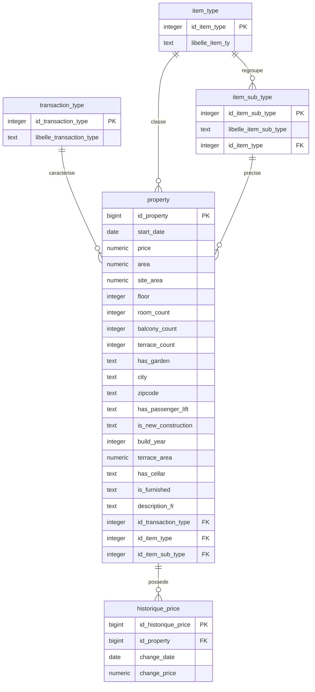

# aviv_etl – Pipeline ETL PySpark vers PostgreSQL

Projet **config-driven** pour ingérer un jeu de données *listings* (CSV), appliquer des transformations (SQL ou Python),
faire des **contrôles qualité** (Great Expectations) puis **charger** les données en **Parquet** (silver) et en **PostgreSQL**
(gold) dans les tables  modélisé comme `property`, `historique_price` etc .

---

## Vue d’ensemble

- **Langage** : Python
- **Moteur** : PySpark (Spark local `local[4]`)
- **Qualité des données** : Great Expectations (validations paramétrables)
- **Stockage** :
  - **RAW(Bronze) / SILVER / GOLD** : chemins paramétrés via `.env`
  - **Parquet** (silver) avec partition par `eventdate`
  - **PostgreSQL** (gold) via JDBC
- **Exécution** : `uv run python local.py` (choisit un job YAML dans `config/`)

---

## Comprendre le pipeline avec Mermaid

Les diagrammes ci-dessous sont accompagnés de fichiers `.mmd` modifiables dans
[`docs/diagrams/`](docs/diagrams/).

### Parcours des données : Bronze → Silver → Gold

Source : [`data-flow.mmd`](docs/diagrams/data-flow.mmd), d’après les configurations
[Silver](config/silver/listing.yaml) et [Gold](config/gold/listing.yaml).

```mermaid
flowchart TB
  raw["Bronze &#58; RAW/listings.csv"]
  qs["Contrôles Silver &#58; nullité, unicité, code postal"]
  tech["Création de listing_tech_id"]
  clean["Remplacement des valeurs nulles configurées"]
  filter["Filtrage SQL &#58; listing_id &gt; 0"]
  types["Nettoyage des catégories"]
  silver["Silver &#58; Parquet partitionné par eventdate"]
  qg["Contrôles Gold &#58; nullité et unicité"]
  sql["Transformations SQL &#58; référentiels, biens et prix"]
  gold["Gold &#58; PostgreSQL via JDBC"]
  refs["transaction_type, item_type, item_sub_type"]
  property["property"]
  history["historique_price"]
  logs["Rapports qualité &#58; SILVER/ge_logs en NDJSON"]
  raw --> qs
  qs --> tech
  tech --> clean
  clean --> filter
  filter --> types
  types --> silver
  silver --> qg
  qg --> sql
  sql --> gold
  gold --> refs
  gold --> property
  gold --> history
  qs --> logs
  qg --> logs
%% portable-canonical-v2:eyJhY2Nlc3NpYmlsaXR5IjpudWxsLCJkYXRhIjp7ImRpcmVjdGlvbiI6IlRCIiwiZWRnZXMiOlt7ImZyb20iOiJyYXciLCJ0byI6InFzIn0seyJmcm9tIjoicXMiLCJ0byI6InRlY2gifSx7ImZyb20iOiJ0ZWNoIiwidG8iOiJjbGVhbiJ9LHsiZnJvbSI6ImNsZWFuIiwidG8iOiJmaWx0ZXIifSx7ImZyb20iOiJmaWx0ZXIiLCJ0byI6InR5cGVzIn0seyJmcm9tIjoidHlwZXMiLCJ0byI6InNpbHZlciJ9LHsiZnJvbSI6InNpbHZlciIsInRvIjoicWcifSx7ImZyb20iOiJxZyIsInRvIjoic3FsIn0seyJmcm9tIjoic3FsIiwidG8iOiJnb2xkIn0seyJmcm9tIjoiZ29sZCIsInRvIjoicmVmcyJ9LHsiZnJvbSI6ImdvbGQiLCJ0byI6InByb3BlcnR5In0seyJmcm9tIjoiZ29sZCIsInRvIjoiaGlzdG9yeSJ9LHsiZnJvbSI6InFzIiwidG8iOiJsb2dzIn0seyJmcm9tIjoicWciLCJ0byI6ImxvZ3MifV0sIm5vZGVzIjpbeyJpZCI6InJhdyIsImxhYmVsIjoiQnJvbnplIDogUkFXL2xpc3RpbmdzLmNzdiJ9LHsiaWQiOiJxcyIsImxhYmVsIjoiQ29udHLDtGxlcyBTaWx2ZXIgOiBudWxsaXTDqSwgdW5pY2l0w6ksIGNvZGUgcG9zdGFsIn0seyJpZCI6InRlY2giLCJsYWJlbCI6IkNyw6lhdGlvbiBkZSBsaXN0aW5nX3RlY2hfaWQifSx7ImlkIjoiY2xlYW4iLCJsYWJlbCI6IlJlbXBsYWNlbWVudCBkZXMgdmFsZXVycyBudWxsZXMgY29uZmlndXLDqWVzIn0seyJpZCI6ImZpbHRlciIsImxhYmVsIjoiRmlsdHJhZ2UgU1FMIDogbGlzdGluZ19pZCA-IDAifSx7ImlkIjoidHlwZXMiLCJsYWJlbCI6Ik5ldHRveWFnZSBkZXMgY2F0w6lnb3JpZXMifSx7ImlkIjoic2lsdmVyIiwibGFiZWwiOiJTaWx2ZXIgOiBQYXJxdWV0IHBhcnRpdGlvbm7DqSBwYXIgZXZlbnRkYXRlIn0seyJpZCI6InFnIiwibGFiZWwiOiJDb250csO0bGVzIEdvbGQgOiBudWxsaXTDqSBldCB1bmljaXTDqSJ9LHsiaWQiOiJzcWwiLCJsYWJlbCI6IlRyYW5zZm9ybWF0aW9ucyBTUUwgOiByw6lmw6lyZW50aWVscywgYmllbnMgZXQgcHJpeCJ9LHsiaWQiOiJnb2xkIiwibGFiZWwiOiJHb2xkIDogUG9zdGdyZVNRTCB2aWEgSkRCQyJ9LHsiaWQiOiJyZWZzIiwibGFiZWwiOiJ0cmFuc2FjdGlvbl90eXBlLCBpdGVtX3R5cGUsIGl0ZW1fc3ViX3R5cGUifSx7ImlkIjoicHJvcGVydHkiLCJsYWJlbCI6InByb3BlcnR5In0seyJpZCI6Imhpc3RvcnkiLCJsYWJlbCI6Imhpc3RvcmlxdWVfcHJpY2UifSx7ImlkIjoibG9ncyIsImxhYmVsIjoiUmFwcG9ydHMgcXVhbGl0w6kgOiBTSUxWRVIvZ2VfbG9ncyBlbiBOREpTT04ifV19LCJkZXNjcmlwdGlvbiI6bnVsbCwiaWQiOiJkYXRhLWZsb3ciLCJraW5kIjoiZmxvd2NoYXJ0Iiwic291cmNlU2hhMjU2IjoiZDIxOWZmYzNhMGFlOWE3ZDY3Y2I1N2I3YTdjNDIwZTczMjhmMThhMmFmZjYwMDE1MjZkOTA5OWJiZWYyM2Q3ZSIsInN0eWxlcyI6W10sInRpdGxlIjoiUGFyY291cnMgZGVzIGRvbm7DqWVzIiwidmVyc2lvbiI6MX0
```



Les jobs Silver et Gold se lancent séparément en choisissant leur YAML dans `local.py`.
Le loader Parquet ajoute la date d’exécution dans `eventdate`. Le YAML Gold pointe
actuellement vers `eventdate=2025-08-26` : adaptez ce chemin à la partition Silver à lire.

### Orchestration d’un job

Source : [`pipeline.mmd`](docs/diagrams/pipeline.mmd), d’après
[`Pipeline.run()`](src/pipeline.py) et [`WrapperPipeline`](src/wrapper_pipeline.py).

```mermaid
flowchart TB
  entry["local.py &#58; choix du YAML Silver ou Gold"]
  context["ExecutionContext &#58; YAML et variables .env"]
  config["GroupConfig et session Spark"]
  wrapper["WrapperPipeline &#58; jobs enable triés par order"]
  extract["Pipeline &#58; extraction des inputs"]
  quality["quality_gate optionnel sur les données extraites"]
  transform["Transformations SQL ou Python dans l’ordre du YAML"]
  load["Chargement des outputs &#58; Parquet ou PostgreSQL"]
  status["WrapperPipeline &#58; statut et durée, puis job suivant"]
  logs["CoreValidator &#58; rapports NDJSON"]
  entry --> context
  context --> config
  config --> wrapper
  wrapper --> extract
  extract --> quality
  quality --> transform
  transform --> load
  load --> status
  quality --> logs
%% portable-canonical-v2:eyJhY2Nlc3NpYmlsaXR5IjpudWxsLCJkYXRhIjp7ImRpcmVjdGlvbiI6IlRCIiwiZWRnZXMiOlt7ImZyb20iOiJlbnRyeSIsInRvIjoiY29udGV4dCJ9LHsiZnJvbSI6ImNvbnRleHQiLCJ0byI6ImNvbmZpZyJ9LHsiZnJvbSI6ImNvbmZpZyIsInRvIjoid3JhcHBlciJ9LHsiZnJvbSI6IndyYXBwZXIiLCJ0byI6ImV4dHJhY3QifSx7ImZyb20iOiJleHRyYWN0IiwidG8iOiJxdWFsaXR5In0seyJmcm9tIjoicXVhbGl0eSIsInRvIjoidHJhbnNmb3JtIn0seyJmcm9tIjoidHJhbnNmb3JtIiwidG8iOiJsb2FkIn0seyJmcm9tIjoibG9hZCIsInRvIjoic3RhdHVzIn0seyJmcm9tIjoicXVhbGl0eSIsInRvIjoibG9ncyJ9XSwibm9kZXMiOlt7ImlkIjoiZW50cnkiLCJsYWJlbCI6ImxvY2FsLnB5IDogY2hvaXggZHUgWUFNTCBTaWx2ZXIgb3UgR29sZCJ9LHsiaWQiOiJjb250ZXh0IiwibGFiZWwiOiJFeGVjdXRpb25Db250ZXh0IDogWUFNTCBldCB2YXJpYWJsZXMgLmVudiJ9LHsiaWQiOiJjb25maWciLCJsYWJlbCI6Ikdyb3VwQ29uZmlnIGV0IHNlc3Npb24gU3BhcmsifSx7ImlkIjoid3JhcHBlciIsImxhYmVsIjoiV3JhcHBlclBpcGVsaW5lIDogam9icyBlbmFibGUgdHJpw6lzIHBhciBvcmRlciJ9LHsiaWQiOiJleHRyYWN0IiwibGFiZWwiOiJQaXBlbGluZSA6IGV4dHJhY3Rpb24gZGVzIGlucHV0cyJ9LHsiaWQiOiJxdWFsaXR5IiwibGFiZWwiOiJxdWFsaXR5X2dhdGUgb3B0aW9ubmVsIHN1ciBsZXMgZG9ubsOpZXMgZXh0cmFpdGVzIn0seyJpZCI6InRyYW5zZm9ybSIsImxhYmVsIjoiVHJhbnNmb3JtYXRpb25zIFNRTCBvdSBQeXRob24gZGFucyBs4oCZb3JkcmUgZHUgWUFNTCJ9LHsiaWQiOiJsb2FkIiwibGFiZWwiOiJDaGFyZ2VtZW50IGRlcyBvdXRwdXRzIDogUGFycXVldCBvdSBQb3N0Z3JlU1FMIn0seyJpZCI6InN0YXR1cyIsImxhYmVsIjoiV3JhcHBlclBpcGVsaW5lIDogc3RhdHV0IGV0IGR1csOpZSwgcHVpcyBqb2Igc3VpdmFudCJ9LHsiaWQiOiJsb2dzIiwibGFiZWwiOiJDb3JlVmFsaWRhdG9yIDogcmFwcG9ydHMgTkRKU09OIn1dfSwiZGVzY3JpcHRpb24iOm51bGwsImlkIjoicGlwZWxpbmUiLCJraW5kIjoiZmxvd2NoYXJ0Iiwic291cmNlU2hhMjU2IjoiZjkyMjE3ZDhkYzhlMTI5OTNmZDlkM2VhNDhkYTgxYTAzNjY0Y2IyNDQwZTAzZWZiZWFiZTFmM2NlMjczNDc2ZCIsInN0eWxlcyI6W10sInRpdGxlIjoiRXjDqWN1dGlvbiBk4oCZdW4gam9iIiwidmVyc2lvbiI6MX0
```



Les contrôles qualité s’exécutent **avant les transformations**, sur les données extraites.
`CoreValidator` écrit les résultats dans `${SILVER}/ge_logs/` au format NDJSON ;
un résultat qualité négatif ne bloque pas à lui seul la suite du job.
Si une étape lève une exception, le wrapper marque le job `Fails` et passe au suivant.

---

## Structure du repo

```
aviv_etl/
├─ local.py                       # point d’entrée : lance un pipeline à partir d’un YAML
├─ src/
│  ├─ execution_context.py        # lit .env + YAML, résout les chemins, instancie Spark
│  ├─ wrapper_pipeline.py         # enchaîne les jobs (GroupConfig) + timing & statut
│  ├─ pipeline.py                 # orchestration d’un job (inputs → quality_gate → transforms → outputs)
│  ├─ extract/                    # Extractor générique (CSV/...) : schéma DDL, options Spark
│  ├─ transform/                  # SQL ou fonctions Python (freestyle): normalisation, utils
│  ├─ load/                       # loaders Parquet & PostgreSQL (JDBC)
│  ├─ validators/                 # Great Expectations – contrôles colonnes/règles
│  └─ utils/                      # Spark helper + lecture des fichiers YAML
├─ docs/diagrams/                # sources Mermaid : parcours, orchestration et modèle de données
├─ config/
│  ├─ silver/listing.yaml         # job silver : RAW (Bronze) ou Bronze → nettoyage → Parquet (partition eventdate)
│  └─ gold/listing.yaml           # job gold : silver → quality gate → Postgres
├─ initdb/init_listing_table.sql  # DDL PostgreSQL (property, historique_price, dictionnaires)
├─ docker-compose.yaml            # Postgres + pgAdmin
├─ .env                           # variables (DB_*, RAW(Bronze), SILVER, GOLD)
├─ pyproject.toml                 # dépendances et outils de développement
├─ uv.lock                        # versions résolues reproductibles
└─ .python-version                # Python 3.12 par défaut
```

---

##  Prérequis

- **Python** 3.11 ou 3.12 (3.12 sélectionné par `.python-version`)
- **Java JDK** ≥ 17 (requis par PySpark 4)
- **PostgreSQL** via Docker Compose
- **uv** ([installation officielle](https://docs.astral.sh/uv/getting-started/installation/))
---

## Configuration (.env)

Exemple de `.env` à la racine du projet :

```env
# --- Base de données ---
DB_USER=user
DB_PASSWORD=pwd
DB_NAME=postgres_db_name
DB_HOST=localhost
DB_PORT=5432

# --- Data Lake local ---
RAW=./datalake/raw
SILVER=./datalake/silver
GOLD=./datalake/gold
```

> Créez les dossiers `./datalake/{raw,silver,gold}` et placez votre `listings.csv` dans `${RAW}`.

---

## Base de données (Docker)

Un `docker-compose.yaml` est fourni pour Postgres + pgAdmin. Démarrer :

```bash
docker compose up -d
# Vérifier la santé
docker inspect --format='{{.State.Health.Status}}' postgres_db
```

Initialiser le schéma (tables `property`, `historique_price`, etc.) :

```bash
# Méthode 1 : psql local
psql "postgres://db:db@localhost:5432/postgres_db" -f initdb/init_listing_table.sql

# Méthode 2 : via le conteneur
docker exec -i postgres_db psql -U db -d postgres_db < initdb/init_listing_table.sql
```

pgAdmin : http://localhost:5050 (admin@admin.com / admin). Ajoutez un serveur vers `postgres_db:5432` (user: `db`, pass: `db`).

---

## Installation

```bash
uv sync --locked
```

`uv` crée `.venv` et installe les dépendances de `uv.lock`, y compris le groupe
`dev` (pytest, pytest-html et flake8). Aucune activation manuelle n’est nécessaire.
Pour installer uniquement les dépendances du pipeline : `uv sync --locked --no-dev`.
Python 3.12 est sélectionné par défaut ; la plage 3.11–3.12 conserve la compatibilité
avec les versions existantes de pandas et Great Expectations.

Gestion des dépendances :

```bash
uv add nom-du-paquet             # dépendance du pipeline
uv add --dev nom-du-paquet       # outil de développement
uv lock                         # actualiser le verrou après modification du pyproject
uv sync --locked                # synchroniser l’environnement
```

Versionnez `pyproject.toml`, `uv.lock` et `.python-version` ensemble.
Voir la [documentation du verrouillage uv](https://docs.astral.sh/uv/concepts/projects/sync/).

## Tests

Avec Java 17 ou supérieur disponible via `JAVA_HOME` ou le `PATH` :

```bash
uv run --locked python -m pytest tests
# Rapport HTML facultatif
uv run --locked python -m pytest tests --html=reports/report.html --self-contained-html
```


---

## Exécution

1) Vérifiez `.env` (chemins RAW/SILVER/GOLD + DB).  
2) Placez **`listings.csv`** dans `${RAW}`.  
3) Sélectionnez le job dans `local.py` :

```python
# local.py
context = ExecutionContext(
    # specification_file="config/silver/listing.yaml"
    specification_file="config/gold/listing.yaml"
)
```

- **Silver** : lit `${RAW}/listings.csv`, nettoie/normalise, écrit en **Parquet** dans `${SILVER}/listing` (partition `eventdate=YYYY-MM-DD`).  
- **Gold** : lit la partition silver configurée (ex: `${SILVER}/listing/eventdate=2025-08-26`), exécute **quality gate**, charge Postgres dans **`property`** et **`historique_price`**.

Lancez :

```bash
uv run python local.py
```
NB :
> Le Spark local est  configuré sur `local[4]`, mémoire driver 4g.  
> Le connecteur JDBC Postgres peut être chargé via `spark.jars.packages=org.postgresql:postgresql:42.7.4`.

---

## Contrôles qualité (Great Expectations)

La section `quality_gate` des YAML (ex: `config/gold/listing.yaml`) déclenche un validateur (présence / nullité / types / cardinalités).  
Les résultats peuvent être exportés (events JSON).  
Pour désactiver : commentez la section `quality_gate` du YAML gold.

---

## Schéma de données (Gold / PostgreSQL)

Le diagramme suivant présente la modélisation des biens immobiliers, des types de
transaction, des catégories de biens et de l’historique des prix.

Source modifiable : [`data-model.mmd`](docs/diagrams/data-model.mmd).



`PK` désigne une clé primaire et `FK` une clé étrangère. Chaque bien possède un
seul type de transaction, un seul type et un seul sous-type. Un type ou un
sous-type peut être associé à zéro ou plusieurs biens. Chaque sous-type appartient
à un seul type ; chaque changement de prix appartient à un seul bien, qui peut
avoir zéro ou plusieurs changements de prix.

Les noms des colonnes et les types suivent le script SQL, avec deux attributs
supplémentaires issus de l’image : `is_furnished` et `description_fr`, présents dans
les données sources mais absents de la table SQL `property` actuelle.


Le script `initdb/init_listing_table.sql` gère :

- Tables : `transaction_type`, `item_type`, `item_sub_type`
- **`property`** (colonnes : `id_property`, `start_date`, `price`, `area`, `site_area`, `floor`, `room_count`, `balcony_count`, `terrace_count`, `has_garden`, `city`, `zipcode`, `has_passenger_lift`, `is_new_construction`, `build_year`, `terrace_area`, `has_cellar`, `id_transaction_type`, `id_item_type`, `id_item_sub_type`)
- **`historique_price`** (suivi des changements de prix par `id_property`)


---

## YAML de pipeline (structure)

Chaque job YAML contient :

- **`inputs`** : sources (format, options Spark, schéma DDL, filtrage, sélection de colonnes)
- **`transforms`** : transformations en chaîne (SQL ou Python *freestyle*)
- **`quality_gate`** *(optionnel)* : validations Great Expectations
- **`outputs`** : loaders (Parquet et/ou Postgres)

Plusieurs jobs peuvent être regroupés (GroupConfig) et exécutés séquentiellement par un wrapper.

---

## Débogage & problèmes fréquents

- **`ModuleNotFoundError: No module named 'pyspark'`** : lancez `uv sync --locked` et vérifiez **Java (JDK 17+)** + `JAVA_HOME`.
- **`great_expectations` introuvable** : `uv sync --locked`, puis lancez les commandes avec `uv run`.
- **Connexion Postgres refusée** : vérifiez Docker et `.env` (`DB_HOST`, `DB_PORT`, `DB_USER`, `DB_PASSWORD`, `DB_NAME`).
- **Chemins RAW/SILVER/GOLD** : créez les dossiers, placez `listings.csv` sous `${RAW}`.

---


## Récapitulatif rapide

```bash
# 1) Préparer l’env
uv sync --locked

# 2) Démarrer Postgres
docker compose up -d
psql "postgres://db:db@localhost:5432/postgres_db" 

# 3) Configurer
# Éditez .env (RAW/SILVER/GOLD + DB_*)

# 4) Lancer
uv run python local.py
```

