# QuantFoundry – Traitements batch de données de marché

QuantFoundry exécute des pipelines configurables avec **pandas, Polars et Spark**.
Le cas métier de surveillance de marché traite **le même fichier de transactions**
avec chaque moteur : nettoyage, bougies à la minute, indicateurs et détection
conjointe des pics de volume et des mouvements de prix.

Les sorties sont des **tables Apache Iceberg pour Spark** et des **fichiers
Parquet pour pandas et Polars**. Une alerte est une ligne de données à examiner ;
aucun service de notification n’est nécessaire.

## Cas métier : surveillance du marché

Un analyste veut repérer les minutes où le volume et le prix varient fortement
sur BTCUSDT et ETHUSDT. Les trois implémentations utilisent les API natives de
leur moteur, sans conversion du traitement Spark ou Polars vers pandas.

### Même source, trois exécutions

Source modifiable : [`market-flow.mmd`](docs/diagrams/market-flow.mmd).

```mermaid
flowchart TB
  source["Démonstration ou transactions Binance"]
  raw["Bronze commun &#58; trades.parquet"]
  pd["pandas &#58; nettoyage et calculs natifs"]
  pl["Polars &#58; nettoyage et calculs natifs"]
  sp["Spark &#58; nettoyage et calculs distribués"]
  pdp["Parquet &#58; trades, indicators, alerts"]
  plp["Parquet &#58; trades, indicators, alerts"]
  ice["Iceberg &#58; local.market.trades, indicators, alerts"]
  source --> raw
  raw --> pd
  raw --> pl
  raw --> sp
  pd --> pdp
  pl --> plp
  sp --> ice
%% portable-canonical-v2:eyJhY2Nlc3NpYmlsaXR5IjpudWxsLCJkYXRhIjp7ImRpcmVjdGlvbiI6IlRCIiwiZWRnZXMiOlt7ImZyb20iOiJzb3VyY2UiLCJ0byI6InJhdyJ9LHsiZnJvbSI6InJhdyIsInRvIjoicGQifSx7ImZyb20iOiJyYXciLCJ0byI6InBsIn0seyJmcm9tIjoicmF3IiwidG8iOiJzcCJ9LHsiZnJvbSI6InBkIiwidG8iOiJwZHAifSx7ImZyb20iOiJwbCIsInRvIjoicGxwIn0seyJmcm9tIjoic3AiLCJ0byI6ImljZSJ9XSwibm9kZXMiOlt7ImlkIjoic291cmNlIiwibGFiZWwiOiJEw6ltb25zdHJhdGlvbiBvdSB0cmFuc2FjdGlvbnMgQmluYW5jZSJ9LHsiaWQiOiJyYXciLCJsYWJlbCI6IkJyb256ZSBjb21tdW4gOiB0cmFkZXMucGFycXVldCJ9LHsiaWQiOiJwZCIsImxhYmVsIjoicGFuZGFzIDogbmV0dG95YWdlIGV0IGNhbGN1bHMgbmF0aWZzIn0seyJpZCI6InBsIiwibGFiZWwiOiJQb2xhcnMgOiBuZXR0b3lhZ2UgZXQgY2FsY3VscyBuYXRpZnMifSx7ImlkIjoic3AiLCJsYWJlbCI6IlNwYXJrIDogbmV0dG95YWdlIGV0IGNhbGN1bHMgZGlzdHJpYnXDqXMifSx7ImlkIjoicGRwIiwibGFiZWwiOiJQYXJxdWV0IDogdHJhZGVzLCBpbmRpY2F0b3JzLCBhbGVydHMifSx7ImlkIjoicGxwIiwibGFiZWwiOiJQYXJxdWV0IDogdHJhZGVzLCBpbmRpY2F0b3JzLCBhbGVydHMifSx7ImlkIjoiaWNlIiwibGFiZWwiOiJJY2ViZXJnIDogbG9jYWwubWFya2V0LnRyYWRlcywgaW5kaWNhdG9ycywgYWxlcnRzIn1dfSwiZGVzY3JpcHRpb24iOm51bGwsImlkIjoibWFya2V0LWZsb3ciLCJraW5kIjoiZmxvd2NoYXJ0Iiwic291cmNlU2hhMjU2IjoiMWVkMzQwNjdkYWNjYmIwMWNlMmZhNTY4NThjZTZjYmE5ZTIxNmI4MDA5MDg3MzIyMmU4Y2UxZTQyZThlOTE4YyIsInN0eWxlcyI6W10sInRpdGxlIjoiTcOqbWUgZmx1eCwgdHJvaXMgbW90ZXVycyIsInZlcnNpb24iOjF9
```



L’entrée Bronze commune utilise ce contrat :

| Colonne | Type | Description |
| --- | --- | --- |
| `symbol` | string | Instrument, par exemple BTCUSDT |
| `trade_id` | int64 | Identifiant unique au sein d’un instrument |
| `timestamp_us` | int64 | Microsecondes depuis l’époque Unix, en UTC |
| `price` | float64 | Prix d’exécution |
| `quantity` | float64 | Quantité dans l’actif de base |

Les prix et quantités sont des flottants destinés à l’analyse ; les comparaisons
entre moteurs utilisent une tolérance numérique, pas une égalité binaire.

### Démarrage rapide, sans réseau

```bash
uv sync --locked
export RAW=./datalake/raw
export SILVER=./datalake/silver
export GOLD=./datalake/gold

# Génère 452 lignes : 450 transactions valides, un doublon et une ligne invalide.
uv run python -m src.market.prepare --mode demo

uv run python local.py --config config/market/pandas.yaml
uv run python local.py --config config/market/polars.yaml

# Spark : Java 17+, accès à Maven lors du premier chargement du connecteur.
export ICEBERG_WAREHOUSE=./datalake/iceberg
uv run python local.py --config config/market/spark.yaml
```

Pour exécuter les trois jobs à la suite :

```bash
uv run python local.py --config config/market
```

Le runtime et le catalogue Iceberg `local` sont activés automatiquement pour
les jobs utilisant `IcebergLoader` ou une entrée de format `iceberg`. Pour un groupe
de jobs, cette configuration est préparée dès la première session Spark.
`ICEBERG_ENABLED=true` reste disponible pour une activation manuelle.

Les chemins peuvent aussi être définis dans `.env`. Les trois YAML sont dans
[`config/market/`](config/market/), et les calculs dans
[`src/market/surveillance.py`](src/market/surveillance.py).
Le téléchargement/générateur est dans [`src/market/prepare.py`](src/market/prepare.py).

### Étapes du job `market_surveillance_polars`

Le job est défini dans [`config/market/polars.yaml`](config/market/polars.yaml).
`enable: true` l’active, `engine: polars` sélectionne Polars pour lire,
transformer et écrire les données, et `order: 2` fixe son ordre lorsque plusieurs
jobs sont exécutés ensemble. Les étapes s’enchaînent par leurs noms : le champ
`inputs` de chaque transformation désigne le résultat de l’étape précédente.
`FreeStyleTransformer` appelle la fonction Python indiquée dans `function_name`.

Le schéma suit les noms du YAML. Les volumes correspondent au mode `demo` ;
les chemins utilisent les répertoires par défaut. Les trois branches de sortie
montrent quel résultat chaque `FileLoader` écrit avec `mode: overwrite`.

Source modifiable : [`market-polars-steps.mmd`](docs/diagrams/market-polars-steps.mmd).

```mermaid
flowchart TB
  prepare["1. Préparation hors du job &#58; générer la démo"]
  raw["Bronze &#58; raw/market/trades.parquet — 452 lignes"]
  extract["2. trades &#58; lire le Parquet avec Polars — 452 lignes"]
  clean["3. clean_trades &#58; convertir les types, retirer les lignes invalides et les doublons — 450 transactions"]
  bars["4. minute_bars &#58; regrouper par symbole et minute UTC — OHLC, volume, VWAP — 150 bougies"]
  indicators["5. indicators &#58; historique des 60 minutes précédentes, rendement et volatilité — 150 lignes"]
  rule["alert = historique complet ET volume &gt; 3 fois la moyenne ET variation absolue du prix &gt; 2 %"]
  alerts["6. alerts &#58; garder uniquement alert = true — 2 alertes"]
  silver["7. FileLoader &#58; silver/market/polars/trades.parquet — 450 lignes"]
  gold_ind["7. FileLoader &#58; gold/market/polars/indicators.parquet — 150 lignes, alert vrai ou faux"]
  gold_alerts["7. FileLoader &#58; gold/market/polars/alerts.parquet — 2 lignes"]
  prepare --> raw
  raw --> extract
  extract --> clean
  clean --> bars
  bars --> indicators
  indicators --> rule
  rule --> alerts
  clean --> silver
  rule --> gold_ind
  alerts --> gold_alerts
%% portable-canonical-v2:eyJhY2Nlc3NpYmlsaXR5IjpudWxsLCJkYXRhIjp7ImRpcmVjdGlvbiI6IlRCIiwiZWRnZXMiOlt7ImZyb20iOiJwcmVwYXJlIiwidG8iOiJyYXcifSx7ImZyb20iOiJyYXciLCJ0byI6ImV4dHJhY3QifSx7ImZyb20iOiJleHRyYWN0IiwidG8iOiJjbGVhbiJ9LHsiZnJvbSI6ImNsZWFuIiwidG8iOiJiYXJzIn0seyJmcm9tIjoiYmFycyIsInRvIjoiaW5kaWNhdG9ycyJ9LHsiZnJvbSI6ImluZGljYXRvcnMiLCJ0byI6InJ1bGUifSx7ImZyb20iOiJydWxlIiwidG8iOiJhbGVydHMifSx7ImZyb20iOiJjbGVhbiIsInRvIjoic2lsdmVyIn0seyJmcm9tIjoicnVsZSIsInRvIjoiZ29sZF9pbmQifSx7ImZyb20iOiJhbGVydHMiLCJ0byI6ImdvbGRfYWxlcnRzIn1dLCJub2RlcyI6W3siaWQiOiJwcmVwYXJlIiwibGFiZWwiOiIxLiBQcsOpcGFyYXRpb24gaG9ycyBkdSBqb2IgOiBnw6luw6lyZXIgbGEgZMOpbW8ifSx7ImlkIjoicmF3IiwibGFiZWwiOiJCcm9uemUgOiByYXcvbWFya2V0L3RyYWRlcy5wYXJxdWV0IOKAlCA0NTIgbGlnbmVzIn0seyJpZCI6ImV4dHJhY3QiLCJsYWJlbCI6IjIuIHRyYWRlcyA6IGxpcmUgbGUgUGFycXVldCBhdmVjIFBvbGFycyDigJQgNDUyIGxpZ25lcyJ9LHsiaWQiOiJjbGVhbiIsImxhYmVsIjoiMy4gY2xlYW5fdHJhZGVzIDogY29udmVydGlyIGxlcyB0eXBlcywgcmV0aXJlciBsZXMgbGlnbmVzIGludmFsaWRlcyBldCBsZXMgZG91YmxvbnMg4oCUIDQ1MCB0cmFuc2FjdGlvbnMifSx7ImlkIjoiYmFycyIsImxhYmVsIjoiNC4gbWludXRlX2JhcnMgOiByZWdyb3VwZXIgcGFyIHN5bWJvbGUgZXQgbWludXRlIFVUQyDigJQgT0hMQywgdm9sdW1lLCBWV0FQIOKAlCAxNTAgYm91Z2llcyJ9LHsiaWQiOiJpbmRpY2F0b3JzIiwibGFiZWwiOiI1LiBpbmRpY2F0b3JzIDogaGlzdG9yaXF1ZSBkZXMgNjAgbWludXRlcyBwcsOpY8OpZGVudGVzLCByZW5kZW1lbnQgZXQgdm9sYXRpbGl0w6kg4oCUIDE1MCBsaWduZXMifSx7ImlkIjoicnVsZSIsImxhYmVsIjoiYWxlcnQgPSBoaXN0b3JpcXVlIGNvbXBsZXQgRVQgdm9sdW1lID4gMyBmb2lzIGxhIG1veWVubmUgRVQgdmFyaWF0aW9uIGFic29sdWUgZHUgcHJpeCA-IDIgJSJ9LHsiaWQiOiJhbGVydHMiLCJsYWJlbCI6IjYuIGFsZXJ0cyA6IGdhcmRlciB1bmlxdWVtZW50IGFsZXJ0ID0gdHJ1ZSDigJQgMiBhbGVydGVzIn0seyJpZCI6InNpbHZlciIsImxhYmVsIjoiNy4gRmlsZUxvYWRlciA6IHNpbHZlci9tYXJrZXQvcG9sYXJzL3RyYWRlcy5wYXJxdWV0IOKAlCA0NTAgbGlnbmVzIn0seyJpZCI6ImdvbGRfaW5kIiwibGFiZWwiOiI3LiBGaWxlTG9hZGVyIDogZ29sZC9tYXJrZXQvcG9sYXJzL2luZGljYXRvcnMucGFycXVldCDigJQgMTUwIGxpZ25lcywgYWxlcnQgdnJhaSBvdSBmYXV4In0seyJpZCI6ImdvbGRfYWxlcnRzIiwibGFiZWwiOiI3LiBGaWxlTG9hZGVyIDogZ29sZC9tYXJrZXQvcG9sYXJzL2FsZXJ0cy5wYXJxdWV0IOKAlCAyIGxpZ25lcyJ9XX0sImRlc2NyaXB0aW9uIjpudWxsLCJpZCI6Im1hcmtldC1wb2xhcnMtc3RlcHMiLCJraW5kIjoiZmxvd2NoYXJ0Iiwic291cmNlU2hhMjU2IjoiNDQ0NTdmYzRjZjgxNDBjNzdjZjMyNTFlMzU4MjA2NmQ4OTYzZjdkNjRhZDQ2ZWM4MWVmZDFlOTFhODZkMzk4MiIsInN0eWxlcyI6W10sInRpdGxlIjoiw4l0YXBlcyBkdSBqb2IgbWFya2V0X3N1cnZlaWxsYW5jZV9wb2xhcnMiLCJ2ZXJzaW9uIjoxfQ
```



**1. Préparer le fichier brut, avant de lancer le job.**
La commande `uv run python -m src.market.prepare --mode demo` crée
`datalake/raw/market/trades.parquet`. Elle génère 450 transactions valides,
ajoute une copie de la première transaction et une transaction avec un prix de
`-1.0` : le fichier contient donc **452 lignes**. Cette préparation est extérieure
au job YAML ; le mode Binance présenté ci-dessous permet de remplacer la démo
par des transactions réelles.

**2. Lire l’entrée `trades`.**
Le job charge `${raw}/market/trades.parquet` au format Parquet dans un DataFrame
Polars. Les cinq champs attendus sont `symbol`, `trade_id`, `timestamp_us`,
`price` et `quantity`.

**3. Nettoyer avec `clean_trades`.**
La fonction `src.market.surveillance.clean_trades` garde ces cinq colonnes et
convertit les champs numériques en nombres : par exemple, le texte `"125.50"`
devient le nombre `125.5`. Une conversion impossible produit `null`, puis la
ligne est supprimée. Elle rejette aussi les symboles vides, les valeurs manquantes
ou non finies (`NaN`, infinis), les prix/quantités inférieurs ou égaux à zéro et
les identifiants/horodatages négatifs ou non entiers. Ces deux derniers champs
sont ensuite convertis en `Int64`.

Pour chaque couple `(symbol, trade_id)`, elle conserve une seule transaction :
le timestamp le plus ancien, puis le prix et la quantité les plus bas en cas
d’égalité. **Dans la démo, 452 lignes deviennent 450** : le doublon et le prix
négatif sont écartés. Le fichier brut reste intact.

**4. Construire les bougies avec `minute_bars`.**
La fonction `src.market.surveillance.minute_bars` regroupe les transactions par
symbole et minute UTC. Elle calcule le premier prix (`open`), le maximum (`high`),
le minimum (`low`), le dernier prix (`close`), la quantité totale (`volume`),
le montant total (`notional = somme(price × quantity)`), le nombre de transactions
et le prix moyen pondéré (`vwap = notional / volume`). Dans la démo,
**450 transactions deviennent 150 bougies** : 75 minutes pour chacun des 2 symboles.

**5. Calculer `indicators` et décider si une minute déclenche une alerte.**
La fonction `src.market.surveillance.detect_anomalies` ajoute à chaque bougie le
rendement sur une minute, la moyenne des volumes passés et la volatilité.
Avec les paramètres de ce YAML, `alert` vaut `true` seulement si les trois
conditions suivantes sont satisfaites :

- `lookback_minutes: 60` et `min_history_minutes: 60` : les 60 minutes précédentes
  sont présentes dans la fenêtre, sans inclure la minute courante ;
- `volume_multiplier: 3.0` : le volume courant dépasse strictement 3 fois la
  moyenne des volumes de cette fenêtre ;
- `price_change_threshold: 0.02` : la variation absolue du prix de clôture par
  rapport à la minute précédente dépasse strictement 2 %.

Les calculs sont séparés par symbole. Les minutes sans transactions ne sont pas
ajoutées. Cette étape conserve **les 150 bougies de la démo**, y compris celles
dont `alert` vaut `false`.

**6. Extraire `alerts`.**
La fonction `src.market.surveillance.alerts_only` garde uniquement les lignes
où `alert = true`. Dans la démo, elle renvoie **2 alertes**, une par symbole à
`2025-01-01 01:05:00 UTC` : le volume est 5 fois la moyenne et le prix augmente de 3 %.

**7. Écrire les trois résultats en Parquet.**
Chaque sortie utilise `src.load.FileLoader` et remplace son fichier précédent
avec `mode: overwrite`.

| Sortie YAML | Résultat utilisé | Destination | Lignes dans la démo |
| --- | --- | --- | --- |
| `market_trades` | `clean_trades` | `${silver}/market/polars/trades.parquet` | 450 |
| `market_indicators` | `indicators` | `${gold}/market/polars/indicators.parquet` | 150 |
| `market_alerts` | `alerts` | `${gold}/market/polars/alerts.parquet` | 2 |

Pour préparer puis exécuter uniquement ce job, avec les chemins par défaut :

```bash
export RAW=./datalake/raw
export SILVER=./datalake/silver
export GOLD=./datalake/gold
uv run python -m src.market.prepare --mode demo
uv run python local.py --config config/market/polars.yaml
```

### Utiliser les transactions réelles Binance

```bash
# Remplace le fichier Bronze : relancer ensuite les jobs pour recalculer les sorties.
uv run python -m src.market.prepare --mode binance \
  --date 2025-01-01 --symbols BTCUSDT ETHUSDT
```

Le téléchargement utilise les archives quotidiennes de transactions spot,
vérifie leur SHA-256 et normalise le CSV par blocs de 250 000 lignes en un fichier
Parquet commun. Le symbole vient du nom de l’archive ; le montant est recalculé
pendant l’agrégation avec `price * quantity`.
Les dates antérieures à 2025 sont converties de millisecondes en microsecondes,
conformément à la [documentation Binance Public Data](https://github.com/binance/binance-public-data#spot).
Le paramètre `--output` permet de choisir un autre fichier ; adapter alors les
URI d’entrée des trois YAML. Cette commande prépare une journée par exécution.

### Règles de calcul communes

Source modifiable : [`market-rules.mmd`](docs/diagrams/market-rules.mmd).

```mermaid
flowchart TB
  trades["Transactions valides et uniques par instrument"]
  bars["Agrégation par minute UTC &#58; OHLC, volume, VWAP"]
  hist["Historique des 60 minutes précédentes, minute courante exclue"]
  ind["Indicateurs &#58; rendement, moyenne du volume, volatilité"]
  rule["Historique complet ET volume supérieur à 3 fois la moyenne ET variation absolue supérieure à 2 %"]
  all["indicators &#58; toutes les minutes avec le booléen alert"]
  alerts["alerts &#58; uniquement les minutes signalées"]
  trades --> bars
  bars --> hist
  hist --> ind
  ind --> rule
  rule --> all
  all --> alerts
%% portable-canonical-v2:eyJhY2Nlc3NpYmlsaXR5IjpudWxsLCJkYXRhIjp7ImRpcmVjdGlvbiI6IlRCIiwiZWRnZXMiOlt7ImZyb20iOiJ0cmFkZXMiLCJ0byI6ImJhcnMifSx7ImZyb20iOiJiYXJzIiwidG8iOiJoaXN0In0seyJmcm9tIjoiaGlzdCIsInRvIjoiaW5kIn0seyJmcm9tIjoiaW5kIiwidG8iOiJydWxlIn0seyJmcm9tIjoicnVsZSIsInRvIjoiYWxsIn0seyJmcm9tIjoiYWxsIiwidG8iOiJhbGVydHMifV0sIm5vZGVzIjpbeyJpZCI6InRyYWRlcyIsImxhYmVsIjoiVHJhbnNhY3Rpb25zIHZhbGlkZXMgZXQgdW5pcXVlcyBwYXIgaW5zdHJ1bWVudCJ9LHsiaWQiOiJiYXJzIiwibGFiZWwiOiJBZ3LDqWdhdGlvbiBwYXIgbWludXRlIFVUQyA6IE9ITEMsIHZvbHVtZSwgVldBUCJ9LHsiaWQiOiJoaXN0IiwibGFiZWwiOiJIaXN0b3JpcXVlIGRlcyA2MCBtaW51dGVzIHByw6ljw6lkZW50ZXMsIG1pbnV0ZSBjb3VyYW50ZSBleGNsdWUifSx7ImlkIjoiaW5kIiwibGFiZWwiOiJJbmRpY2F0ZXVycyA6IHJlbmRlbWVudCwgbW95ZW5uZSBkdSB2b2x1bWUsIHZvbGF0aWxpdMOpIn0seyJpZCI6InJ1bGUiLCJsYWJlbCI6Ikhpc3RvcmlxdWUgY29tcGxldCBFVCB2b2x1bWUgc3Vww6lyaWV1ciDDoCAzIGZvaXMgbGEgbW95ZW5uZSBFVCB2YXJpYXRpb24gYWJzb2x1ZSBzdXDDqXJpZXVyZSDDoCAyICUifSx7ImlkIjoiYWxsIiwibGFiZWwiOiJpbmRpY2F0b3JzIDogdG91dGVzIGxlcyBtaW51dGVzIGF2ZWMgbGUgYm9vbMOpZW4gYWxlcnQifSx7ImlkIjoiYWxlcnRzIiwibGFiZWwiOiJhbGVydHMgOiB1bmlxdWVtZW50IGxlcyBtaW51dGVzIHNpZ25hbMOpZXMifV19LCJkZXNjcmlwdGlvbiI6bnVsbCwiaWQiOiJtYXJrZXQtcnVsZXMiLCJraW5kIjoiZmxvd2NoYXJ0Iiwic291cmNlU2hhMjU2IjoiODM0OTBkNTg2NGU4MzlkYTQyYTgwNDM3MGEwNzkwZjViMjdhMjAxNWJlZjBjNjMyZDdhNjJhYjc0ZjgzZDNlZSIsInN0eWxlcyI6W10sInRpdGxlIjoiRHUgdHJhZGUgw6AgbGEgdGFibGUgZGVzIGFub21hbGllcyIsInZlcnNpb24iOjF9
```



1. **Nettoyage** : suppression des champs requis nuls, des symboles vides, des
   valeurs numériques non finies et des prix/quantités non positifs. Les identifiants
   et horodatages doivent être des entiers positifs ou nuls. Les doublons sur
   `(symbol, trade_id)` sont résolus en conservant le plus petit triplet
   `(timestamp_us, price, quantity)`.
2. **Agrégation** : une ligne par `(symbol, minute)` ; les minutes sont les
   intervalles UTC `[début, début + 60 secondes[`. Open et close suivent l’ordre
   `(timestamp_us, trade_id)`. Calcul de high, low, volume, montant, nombre de
   transactions et `vwap = somme(price × quantity) / somme(quantity)`.
3. **Historique** : pour la minute `t`, la référence couvre `[t − 60 min, t[`.
   Les instruments sont indépendants. Les minutes sans transactions ne sont pas
   créées artificiellement. `history_count` indique les minutes observées ;
   `history_ready` exige par défaut les 60 minutes précédentes.
4. **Indicateurs** : `return_1m = close(t) / close(t−1 min) − 1` ; il est nul
   au sens SQL (`null`/`NaN`) lorsque la minute précédente manque.
   `volume_mean` est la moyenne des volumes passés et `volatility` l’écart-type
   échantillonnal (`ddof=1`) des rendements disponibles dans cette même fenêtre,
   sans annualisation. Moins de deux rendements donne une volatilité manquante.
5. **Détection** : la colonne `alert` vaut vrai si l’historique est suffisant,
   `volume / volume_mean > 3` **et** `abs(return_1m) > 0.02`. Les comparaisons sont
   strictes. Une condition manquante produit `false`.

Les seuils sont des règles de démonstration à calibrer. Ils sont configurés sous
`function_parameters` de la transformation `indicators` dans chaque YAML :

```yaml
lookback_minutes: 60
min_history_minutes: 60
volume_multiplier: 3.0
price_change_threshold: 0.02  # fraction : 0.02 = 2 %
```

Conserver les mêmes paramètres dans les trois YAML pour comparer les moteurs.
L’historique recommence au début du fichier traité : prévoir des données précédentes
si la première heure d’une journée doit déjà être analysable.

### Sorties et résultats attendus

| Données | pandas / Polars | Spark |
| --- | --- | --- |
| Transactions nettoyées | `${SILVER}/market/<engine>/trades.parquet` | `local.market.trades` |
| Toutes les minutes et indicateurs | `${GOLD}/market/<engine>/indicators.parquet` | `local.market.indicators` |
| Minutes avec `alert = true` | `${GOLD}/market/<engine>/alerts.parquet` | `local.market.alerts` |

Le catalogue Iceberg `local` est de type Hadoop et stocke données et métadonnées
sous `ICEBERG_WAREHOUSE`. Ces sorties Spark sont de véritables tables Iceberg,
accessibles avec `spark.table("local.market.alerts")`. Les jobs remplacent leurs
sorties (`overwrite`) ; une réexécution ne duplique pas les transactions.
Les chemins ne servent pas à conserver simultanément plusieurs campagnes :
changer les URI pour archiver plusieurs jeux de résultats.

Les indicateurs contiennent `symbol`, `minute_start` (UTC), `open`, `high`, `low`,
`close`, `volume`, `notional`, `trade_count`, `vwap`, `return_1m`, `history_count`,
`volume_mean`, `volatility`, `history_ready`, `volume_ratio` et `alert`.
`minute_start` est stocké sans fuseau explicite dans les Parquet natifs ; toutes
ses valeurs sont à interpréter en UTC. Spark utilise une session en UTC.

La démonstration produit, pour chaque moteur : **450 transactions nettoyées,
150 minutes et 2 alertes**. Les alertes apparaissent à `2025-01-01 01:05:00 UTC`,
une par instrument : volume de 15 contre une moyenne passée de 3, soit un ratio
de 5, et hausse du prix de 3 %.

```bash
uv run python -c 'import pandas as pd; print(pd.read_parquet("datalake/gold/market/pandas/alerts.parquet").to_string(index=False))'
```

### Vérification et comparaison

```bash
# Calculs métier et pipelines pandas/Polars, sans Java.
uv run python -m pytest tests/test_market_surveillance.py -k 'not spark and not iceberg'

# Ajoute la comparaison des résultats Spark aux résultats natifs.
PYSPARK_PYTHON="$PWD/.venv/bin/python" uv run python -m pytest tests/test_market_surveillance.py

# Vérifie aussi les trois tables Iceberg et la réexécution sans doublons.
RUN_ICEBERG_TESTS=1 PYSPARK_PYTHON="$PWD/.venv/bin/python" \
  PYSPARK_SUBMIT_ARGS='--packages org.apache.iceberg:iceberg-spark-runtime-4.0_2.13:1.10.0 pyspark-shell' \
  uv run python -m pytest tests/test_market_surveillance.py
```

Les tests couvrent les valeurs attendues, les fenêtres sans anticipation,
l’isolation des instruments, les trous temporels, les doublons, l’ordre OHLC,
le VWAP, les entrées vides et les deux unités temporelles Binance.

Les événements JSON `ingestion_metrics` donnent les durées de lecture, de calcul
et d’écriture. La préparation du Bronze est extérieure à ces mesures. Comparer
les durées de transformation séparément des écritures : Parquet et Iceberg ont
des coûts de stockage différents. Le petit jeu de démonstration valide les règles ;
il ne permet pas de conclure sur les performances à grande échelle. pandas et
Polars chargent ici le fichier en mémoire locale ; Spark permet une exécution
distribuée.

### TODO — Améliorer les mesures de performance Spark / Polars

Dans [`src/engines/backend.py`](src/engines/backend.py), la méthode
`SparkEngine.row_count()` appelle `df.persist()` si le DataFrame n’est pas déjà
en cache, puis `df.count()`. `count()` est une méthode du DataFrame PySpark ;
elle n’est pas définie dans `src`. Cet appel vient de `Pipeline._measure()` dans
[`src/pipeline.py`](src/pipeline.py), après chaque extraction et transformation.

Ce mécanisme force le calcul des DataFrames Spark, normalement évalués à la
demande, pour inclure leur exécution dans les durées de chaque étape. Le cache
permet de réutiliser les résultats, mais les comptages et la matérialisation
ajoutent du travail et consomment de la mémoire. Le benchmark mesure donc aussi
le coût de cette instrumentation.

Sur une exécution locale de 2 698 775 transactions, les durées observées étaient
de **1,08 s pour Polars** et **11,90 s pour Spark**, dont **3,48 s de démarrage
Spark**. Avec `local[4]`, Spark conserve les coûts de gestion des tâches,
des partitions et des échanges nécessaires aux regroupements et aux fenêtres.
Les sorties diffèrent aussi : Spark écrit des tables Iceberg avec métadonnées
et snapshots, tandis que Polars écrit des fichiers Parquet. Cette observation
ne permet pas de conclure sur les performances en cluster ou à plus grand volume.

- [ ] Rendre les comptages intermédiaires configurables et comparer leur coût
  au temps d’une exécution complète sans ces comptages. Sans action Spark,
  le temps de construction du plan seul ne mesure pas le calcul réel.
- [ ] Évaluer quels résultats doivent être conservés en cache pour éviter les
  recalculs, plutôt que de matérialiser systématiquement chaque étape.
- [ ] Ajouter une comparaison avec des sorties Parquet pour les trois moteurs,
  afin de mesurer séparément le coût des écritures Iceberg.
- [ ] Distinguer les exécutions avec démarrage de Spark de celles réutilisant
  une session, et répéter les mesures sur plusieurs volumes de données.
- [ ] Compléter les métriques CPU et mémoire : `python_cpu_s` utilise
  `time.process_time()` et ne couvre pas le CPU de la JVM Spark.

---

## Structure actuelle du projet

```text
QuantFoundry/
├── local.py                     # lancement d’un YAML ou d’un dossier de jobs
├── config/market/
│   ├── pandas.yaml              # ordre 1 : sorties Parquet
│   ├── polars.yaml              # ordre 2 : sorties Parquet, job par défaut
│   └── spark.yaml               # ordre 3 : sorties Iceberg
├── src/
│   ├── market/prepare.py         # génération démo ou téléchargement Binance
│   ├── market/surveillance.py    # nettoyage, bougies, indicateurs, alertes
│   ├── execution_context.py     # chargement YAML et variables .env
│   ├── wrapper_pipeline.py      # jobs actifs triés par order, statuts et métriques
│   ├── pipeline.py              # extraction, contrôles, transformations, chargement
│   ├── engines/                 # moteurs pandas, Polars et Spark
│   ├── extract/                 # extraction des sources
│   ├── transform/               # fonctions Python, SQL et opérations DataFrame
│   ├── load/                    # sorties fichiers, Parquet partitionné et Iceberg
│   ├── validators/              # contrôles de qualité
│   └── utils/                   # configuration et session Spark
├── docs/market-gold.md           # schéma Gold et exemple des alertes obtenues
├── docs/diagrams/                # sources des diagrammes
├── tests/                       # tests métier, moteurs, loaders et orchestration
├── pyproject.toml
└── uv.lock
```

Les configurations exécutables concernent la surveillance du marché : une source
Bronze commune, des transactions nettoyées en Silver et des indicateurs et alertes
en Gold. Le schéma des résultats est décrit dans
[`docs/market-gold.md`](docs/market-gold.md).

## Installation et configuration

Python 3.11 ou 3.12 est requis ; `.python-version` sélectionne Python 3.12.
Les jobs pandas et Polars fonctionnent sans Java. Spark nécessite Java 17 ou
supérieur et le connecteur Iceberg utilisé par le job de marché.

```bash
uv sync --locked
```

`uv` crée `.venv` et installe les dépendances verrouillées, ainsi que les outils
de développement. Pour les seules dépendances d’exécution :
`uv sync --locked --no-dev`.

Définir les chemins dans `.env` ou dans l’environnement :

```env
RAW=./datalake/raw
SILVER=./datalake/silver
GOLD=./datalake/gold

# Emplacement du catalogue Spark / Iceberg
ICEBERG_WAREHOUSE=./datalake/iceberg
```

Les variables d’environnement en majuscules alimentent les paramètres YAML
`${raw}`, `${silver}` et `${gold}`. Le générateur utilise par défaut
`datalake/raw/market/trades.parquet` : si `RAW` change, passer aussi
`--output <nouveau-chemin>/market/trades.parquet` à la commande de préparation.

Après la préparation du fichier brut, `uv run python local.py` lance le job
Polars. `--config` permet de choisir un autre YAML ou le dossier `config/market`.
Le dossier contient aussi le job Spark : Java et Iceberg sont alors nécessaires.

## Tables Gold et consultation des résultats

Le schéma des indicateurs et des alertes, leurs destinations et un extrait des
résultats de démonstration sont décrits dans
[`docs/market-gold.md`](docs/market-gold.md).
Les fichiers Parquet et les tables Iceberg sont créés par les loaders à partir
du schéma des DataFrames ; aucun script SQL préalable n’est nécessaire.

Pour afficher les alertes Polars après l’exécution :

```bash
uv run python -c 'import polars as pl; print(pl.read_parquet("datalake/gold/market/polars/alerts.parquet"))'
```

Le job Spark écrit `local.market.trades`, `local.market.indicators` et
`local.market.alerts`. Le catalogue Hadoop `local` et les extensions Iceberg sont
configurés avant la création de Spark. Le runtime utilisé est
`org.apache.iceberg:iceberg-spark-runtime-4.0_2.13:1.10.0` ; son premier chargement
nécessite un accès à Maven. Le namespace `local.market` est créé automatiquement.
Les URI Iceberg sont des identifiants de tables, pas des chemins Parquet.

Dans une session Spark configurée avec le même catalogue et le même entrepôt :

```python
spark.table("local.market.alerts").show()
spark.sql("SELECT * FROM local.market.alerts.snapshots").show()
```

`IcebergLoader` accepte `overwrite` (création ou remplacement intégral), `append`
(création ou ajout) et `error` (échec si la table existe). Les jobs actuels utilisent
`overwrite`. Les tables sont au format Iceberg v2 ; le stockage local est prévu
pour le développement sur une machine.

## Fonctionnement du framework

`ExecutionContext` lit le YAML et résout les variables. `WrapperPipeline` trie les
jobs actifs par `order`, puis chaque `Pipeline` exécute ses entrées, ses éventuels
contrôles qualité, ses transformations et ses sorties. Spark démarre à la demande ;
une exécution pandas ou Polars ne crée pas de session Spark.

Chaque transformation référence un résultat par son nom. `FreeStyleTransformer`
appelle la fonction Python de `function_name` avec les données et le dictionnaire
`function_parameters`. Le résultat doit être un DataFrame du moteur choisi.
`DataFrameTransformer` propose aussi sélection, filtre, tri, renommage,
dédoublonnage, remplacement des valeurs nulles et agrégation. `SqlTransformer`
utilise SQL Spark ou SQL Polars ; il n’est pas disponible pour pandas.

| Composant | pandas / Polars | Spark |
| --- | --- | --- |
| Lecture CSV, Parquet, JSON, NDJSON | Native | Native |
| `FileLoader` | Fichier local | Dossier de fichiers distribués |
| `ParquetLoader` | Dataset partitionné par `eventdate` | Dataset partitionné par `eventdate` |
| `IcebergLoader` | Non pris en charge | Pris en charge |
| `CoreValidator` | Règles natives | Great Expectations |

Les jobs de marché n’ont pas de section `quality_gate` : leurs règles de nettoyage
sont dans `clean_trades`. Pour un job qui configure cette section, les contrôles
s’exécutent avant les transformations et les rapports sont écrits sous
`${SILVER}/ge_logs/` en NDJSON. Un contrôle négatif ne bloque pas à lui seul le job ;
une exception technique provoque son échec.

Chaque job émet un événement JSON `ingestion_metrics` avec son statut, ses durées,
les volumes en entrée/sortie et le détail des étapes. Les DataFrames Spark sont
matérialisés et mis en cache pendant la mesure, puis les caches sont libérés.
`output_rows` additionne les lignes présentées à chaque sortie réussie : les
transactions, les indicateurs et les alertes contribuent donc séparément au total.
En cas d’échec, les autres jobs continuent et la commande termine avec un code non nul.

## Tests et dépannage

La section « Vérification et comparaison » donne les commandes des tests métier.
Pour la suite complète, avec Java disponible :

```bash
uv run --locked python -m pytest tests
# Rapport HTML facultatif
uv run --locked python -m pytest tests --html=reports/report.html --self-contained-html
```

- Entrée Parquet absente : exécuter la préparation, puis vérifier `RAW` et `--output`.
- Dépendance Python absente : lancer `uv sync --locked` et utiliser `uv run`.
- Spark ne démarre pas : vérifier Java 17+, `JAVA_HOME` et l’accès à Maven.
- Catalogue `local` indisponible : relancer le processus pour créer une nouvelle
  session Spark et vérifier `ICEBERG_WAREHOUSE`. Une session Spark fournie par un
  notebook doit être créée avec `SparkHelper(iceberg_required=True).get_spark()`.
- Pas d’alerte au début du fichier : les 60 minutes précédentes sont nécessaires
  avec les seuils par défaut ; elles ne sont pas chargées depuis une autre exécution.

## Lint Python

GitHub Actions lance un lint léger à chaque push et pull request, avec Python 3.12
et Flake8 7.1.0. Les règles partagées dans [`.flake8`](.flake8) détectent les erreurs
de syntaxe, les noms non définis et certaines constructions invalides
(`E9`, `F63`, `F7`, `F82`). Le formatage et la longueur des lignes ne sont pas
bloquants. Le contrôle porte sur `src/`, `tests/` et `local.py` et ne nécessite
ni Java, ni Spark, ni téléchargement de données.

Pour lancer le même contrôle en local :

```bash
uv run --locked --only-group dev python -m flake8 src tests local.py --count --show-source --statistics
```

Le hook pre-commit utilise les mêmes règles. Les erreurs détectées font échouer
le contrôle ; les tests fonctionnels restent une vérification distincte.
